# Polarization-Resolved Multispectral Imaging for Pre-Harvest Avocado Grading (`Avocado_Grading`)

Non-destructive pre-harvest grading of **Hass avocados (*Persea americana*)** using polarization-resolved multispectral backscattering at **450 nm (Blue), 520 nm (Green), and 650 nm (Red)** against commercial selective-harvest grading (`Mature` = ready to pluck now vs. `Immature` = held on the tree for the next 2-week selective harvest round).

---

## 1. Dataset & Repository Structure

Across the **200 Hass avocados** collected from the Malwatte plantation:
- **200 Unique Fruits:** 100 `Mature` (ready to pluck now) + 100 `Immature` (pluck in the following 2-week round)
- **800 Unique Spatial Spots:** 200 fruits $\times$ 4 orthogonal equatorial sides (`Side1`–`Side4`)
- **2,400 Polarization Curves:** 800 spots $\times$ 3 spectral bands (`450 nm`, `520 nm`, `650 nm`)
- **153,576 Unique Calibrated Intensity Points:** 622 spots captured at $5^\circ$ steps (72 angles, $0^\circ\text{--}355^\circ$) + 178 spots at $10^\circ$ steps (36 angles, $0^\circ\text{--}350^\circ$), dark-subtracted (`0`) and normalized by a white PTFE reference target (`Ref/`)

```text
Avocado_Grading/
├── Malwatte_01/                          # Sample raw test dataset (Mature & Immature raw angle-resolved frames)
│   ├── Mature/Side1/1/                   # Sample Mature fruit (Side 1, 10-deg step raw PNGs)
│   ├── Mature/Side2/27/                  # Sample Mature fruit (Side 2, 5-deg step raw PNGs)
│   ├── Immature/Side1/1/                 # Sample Immature fruit (Side 1, 5-deg step raw PNGs)
│   └── Immature/Side2/1/                 # Sample Immature fruit (Side 2, 5-deg step raw PNGs)
├── Ref/                                  # White PTFE reference & dark frames across all angles (r, g, b, 0)
├── preprocessing/                        # Preprocessing & feature extraction pipelines
│   ├── m01_extract.py                    # Dark-subtracted raw intensity & Malus-law sinusoidal fitting
│   ├── m01_extract_cal.py                # White-reference calibrated reflectance & DoLP extraction
│   ├── m01_extract_v2.py                 # Green-anchored shared-spot 6-ring radial extraction (Sides 1-2)
│   └── m01_extract_v2_s34.py             # Green-anchored shared-spot 6-ring radial extraction (Sides 3-4)
├── analysis_output_m01_cal/              # Preprocessed calibrated feature & intensity tables (all 200 fruits)
│   ├── features_per_side.csv             # Calibrated DoLP, mean reflectance, Imax, Imin per spot & channel
│   ├── features_per_fruit.csv            # Fruit-averaged calibrated optical features (n = 200)
│   └── intensities_long.csv              # All 153,576 calibrated angle-resolved intensity measurements
├── analysis_output_m01_v2/results4/
│   └── spot_features_4sides.csv          # Shared-spot 6 concentric radial rings (DoLP + logRmean, Sides 1-4)
└── farmersClassification/                # Machine Learning classification & angular analysis suite
    ├── 02_classify.py                    # Feature-set ablation across LogReg, SVM-RBF, Random Forest
    ├── 03_classify_10deg_only.py         # Native 5-deg vs. downsampled 10-deg resolution benchmark
    ├── 05_angle_significance.py          # Per-angle Cohen's d and ROC-AUC across all 72 angles
    ├── 06_angle_decomposition.py         # Malus sinusoidal + residual decomposition at 50°, 135°, 140°, 200°
    ├── 08_anisotropy_vs_farmer.py        # Anisotropy & phase analysis vs. grower grading
    ├── 09_fruit_angle_profile.py         # Uncalibrated vs. calibrated angular brightness profiles
    ├── 10_avocado_vs_ref_and_geometry.py # 3D avocado surface vs. flat reference & same-fruit ICC
    ├── 11_angle_uniqueness_all4sides.py  # All-4-sides fruit repeatability across all 72 angles
    ├── 12_ml_algorithms_comparison.py    # Full 9-algorithm ML benchmark, ROC curves & confusion matrices
    └── results/                          # All CSV tables and publication figures (see below)
```

---

## 2. Optical Setup & Preprocessing Pipeline

1. **Dark Subtraction & White-Reference Calibration (`m01_extract_cal.py`):**
   Every illuminated frame $I_{\text{fruit}}(\lambda, \theta)$ is paired with a contemporaneous dark frame $I_{\text{dark}}(\theta)$ and normalized by the angle-matched white PTFE reference target $I_{\text{Ref}}(\lambda, \theta)$:
   $$R(\lambda, \theta) = \frac{I_{\text{fruit}}(\lambda, \theta) - I_{\text{dark}}(\theta)}{I_{\text{Ref}}(\lambda, \theta) - I_{\text{Ref,dark}}(\theta)}$$
2. **Malus-Law Harmonic Fitting:**
   For each spot and wavelength, the 36- or 72-angle reflectance curve is fitted by least squares to:
   $$R(\theta) = c + p\cos(2\theta) + q\sin(2\theta) = c\,[1 + \text{DoLP}\cos 2(\theta - \phi)], \quad \text{DoLP} = \frac{\sqrt{p^2 + q^2}}{c}$$
3. **Green-Anchored Shared-Spot Radial Rings (`m01_extract_v2.py`):**
   To eliminate inter-channel ROI drift and border truncation, the spot centroid is locked on the high-SNR 520 nm green channel and partitioned into 6 concentric radial rings ($r_0\text{--}r_5$, $0\text{--}80\text{ px}$), separating the specular central core from the multiply-scattered subsurface halo.

| Optical Imaging Setup | Preprocessing & Shared-Spot Ring Pipeline |
| :---: | :---: |
| 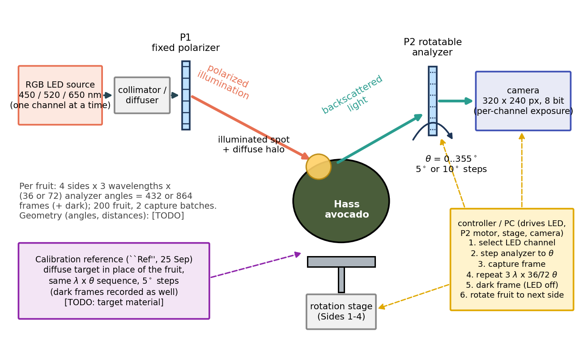 | 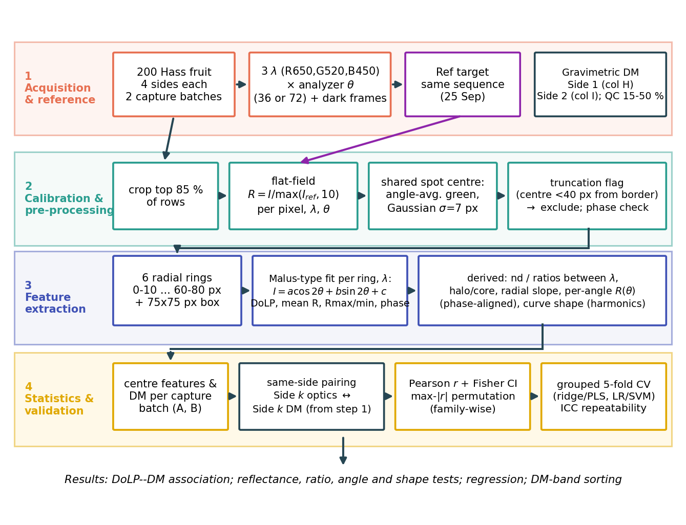 |

| Reference Calibration & Malus Curves | Shared-Spot ROI Alignment Across Angles |
| :---: | :---: |
| 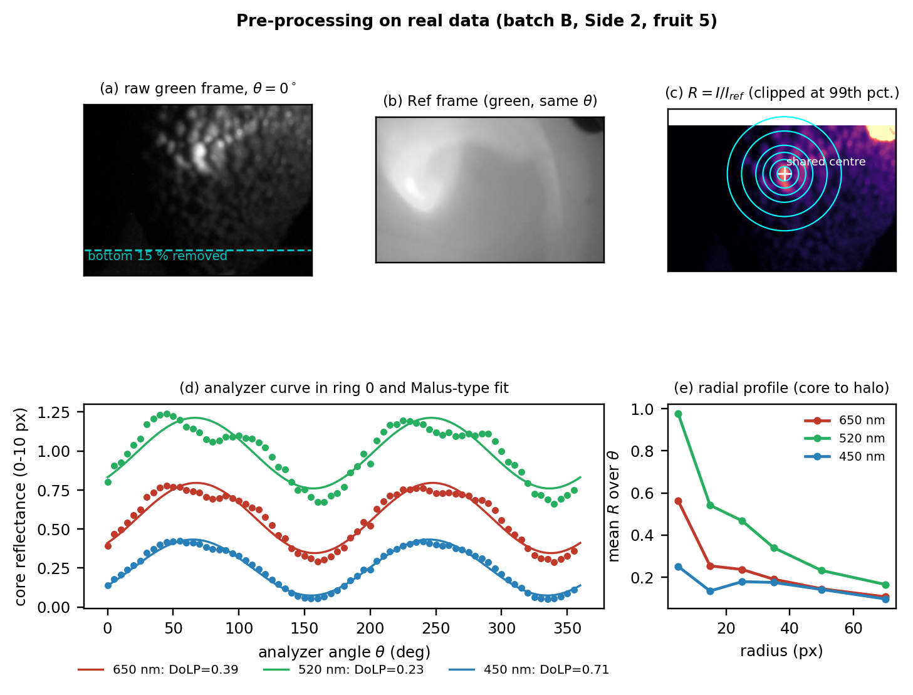 | 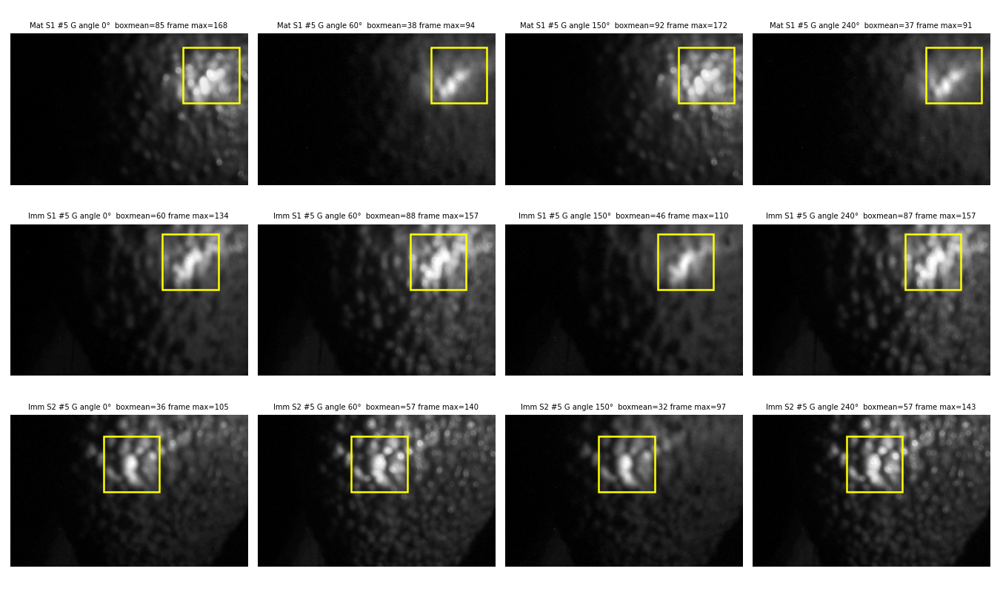 |

---

## 3. Machine Learning Classification Results (9 Algorithms Compared)

All models are evaluated using **$5 \times 5$-fold stratified cross-validation** at the fruit level ($n = 200$ avocados) and **fruit-grouped `StratifiedGroupKFold`** at the spot level ($n = 800$ spots, ensuring all 4 sides of any avocado remain in the same fold). Only pure optical features (`DoLP` and calibrated reflectance) are used as inputs.

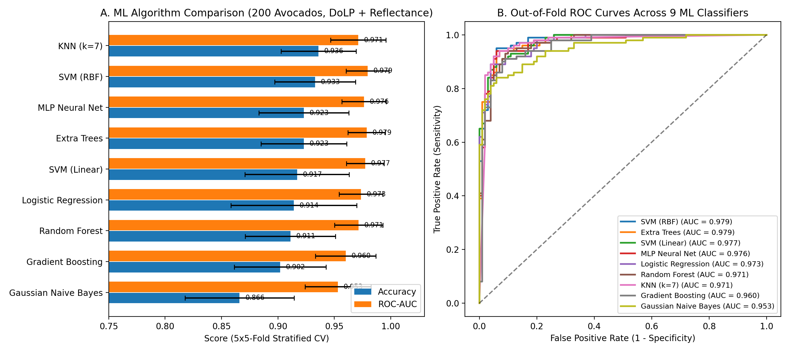

### A. Fruit-Level: Whole-Spot DoLP + Calibrated Reflectance ($n = 200$ Avocados, All 4 Sides Averaged)
Full table: [`farmersClassification/results/ml_algorithms_comparison.csv`](results/ml_algorithms_comparison.csv)

| ML Algorithm | Accuracy ($\pm$ SD) | Balanced Acc | Precision | Recall (Sensitivity) | Specificity | F1-Score | ROC-AUC ($\pm$ SD) |
| :--- | :---: | :---: | :---: | :---: | :---: | :---: | :---: |
| **KNN ($k=7$)** | **93.6% $\pm$ 3.3%** | **93.6%** | 94.8% | **92.4%** | 94.8% | **0.935** | 0.971 $\pm$ 0.017 |
| **SVM (RBF Kernel)** | **93.3% $\pm$ 3.6%** | **93.3%** | **95.1%** | 91.6% | **95.0%** | **0.932** | **0.979 $\pm$ 0.014** |
| **Extra Trees** | 92.3% $\pm$ 3.8% | 92.3% | 94.3% | 90.2% | 94.4% | 0.921 | **0.979 $\pm$ 0.014** |
| **MLP Neural Net** | 92.3% $\pm$ 4.0% | 92.3% | 92.5% | **92.4%** | 92.2% | 0.923 | 0.976 $\pm$ 0.017 |
| **SVM (Linear)** | 91.7% $\pm$ 4.6% | 91.7% | 93.0% | 90.4% | 93.0% | 0.915 | 0.977 $\pm$ 0.015 |
| **Logistic Regression** | 91.4% $\pm$ 5.6% | 91.4% | 92.5% | 90.4% | 92.4% | 0.913 | 0.973 $\pm$ 0.018 |
| **Random Forest** | 91.1% $\pm$ 4.0% | 91.1% | 94.1% | 88.0% | 94.2% | 0.908 | 0.971 $\pm$ 0.017 |
| **Gradient Boosting** | 90.2% $\pm$ 4.1% | 90.2% | 92.0% | 88.4% | 92.0% | 0.900 | 0.960 $\pm$ 0.023 |
| **Gaussian Naive Bayes** | 86.6% $\pm$ 4.8% | 86.6% | 85.6% | 88.6% | 84.6% | 0.868 | 0.953 $\pm$ 0.025 |

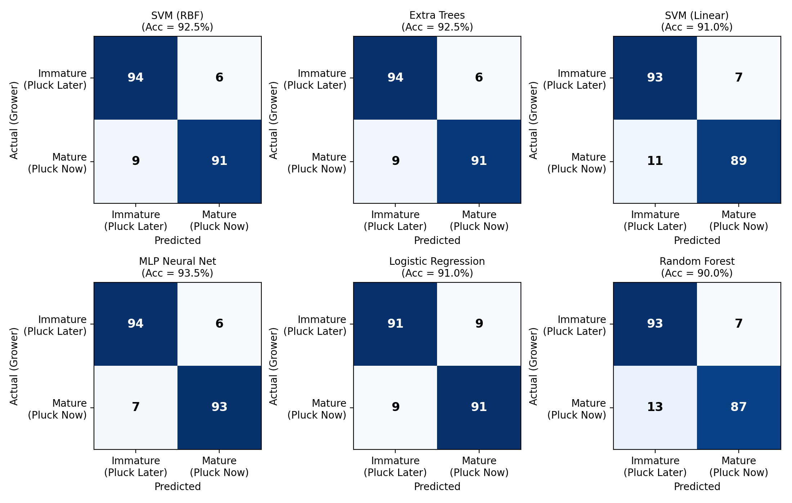

---

### B. Fruit-Level: Shared-Spot 6-Ring Radial Features ($n = 192$ Avocados)

| ML Algorithm | DoLP + Reflectance Accuracy | DoLP + Reflectance F1 | DoLP + Reflectance AUC | **DoLP Rings Only Accuracy** | **DoLP Rings Only AUC** |
| :--- | :---: | :---: | :---: | :---: | :---: |
| **SVM (Linear)** | **93.6% $\pm$ 3.4%** | **0.936** | 0.978 | 89.6% $\pm$ 4.9% | **0.961** |
| **Gaussian Naive Bayes** | 93.5% $\pm$ 3.5% | **0.937** | 0.966 | 84.7% $\pm$ 4.3% | 0.901 |
| **Extra Trees** | 93.3% $\pm$ 3.3% | 0.934 | 0.978 | 87.2% $\pm$ 3.0% | 0.953 |
| **Logistic Regression** | 93.1% $\pm$ 4.0% | 0.931 | **0.979** | 88.8% $\pm$ 4.7% | **0.961** |
| **SVM (RBF Kernel)** | 92.9% $\pm$ 4.0% | 0.930 | 0.973 | **90.4% $\pm$ 3.0%** | **0.961** |
| **Random Forest** | 92.8% $\pm$ 3.5% | 0.929 | 0.972 | 86.8% $\pm$ 3.2% | 0.951 |
| **KNN ($k=7$)** | 92.7% $\pm$ 3.7% | 0.927 | 0.964 | 86.1% $\pm$ 5.1% | 0.941 |
| **Gradient Boosting** | 91.6% $\pm$ 3.9% | 0.915 | 0.968 | 88.7% $\pm$ 3.5% | 0.946 |
| **MLP Neural Net** | 90.9% $\pm$ 4.0% | 0.907 | 0.963 | **90.4% $\pm$ 3.0%** | 0.959 |

---

### C. Spot-Level (Single Side of a Fruit): DoLP + Reflectance ($n = 800$ Spots, Grouped by Fruit)

| ML Algorithm | Accuracy ($\pm$ SD) | Precision | Recall (Sensitivity) | Specificity | F1-Score | ROC-AUC |
| :--- | :---: | :---: | :---: | :---: | :---: | :---: |
| **SVM (RBF Kernel)** | **85.2% $\pm$ 3.0%** | 84.3% | **86.7%** | 83.6% | **0.854** | **0.931** |
| **Gradient Boosting** | 84.9% $\pm$ 3.0% | **85.3%** | 84.5% | **85.2%** | 0.848 | 0.924 |
| **Extra Trees** | 84.8% $\pm$ 2.9% | 84.1% | 86.0% | 83.6% | 0.849 | 0.926 |
| **Random Forest** | 84.8% $\pm$ 3.2% | 84.5% | 85.4% | 84.1% | 0.849 | 0.926 |
| **KNN ($k=7$)** | 84.2% $\pm$ 3.3% | 84.1% | 84.4% | 83.9% | 0.842 | 0.909 |
| **MLP Neural Net** | 84.0% $\pm$ 3.6% | 83.7% | 84.7% | 83.2% | 0.841 | 0.909 |
| **SVM (Linear)** | 83.0% $\pm$ 3.1% | 83.2% | 82.8% | 83.1% | 0.829 | 0.888 |
| **Gaussian Naive Bayes** | 82.6% $\pm$ 2.5% | 81.1% | 85.1% | 80.1% | 0.830 | 0.894 |
| **Logistic Regression** | 81.9% $\pm$ 3.3% | 81.7% | 82.5% | 81.3% | 0.820 | 0.884 |

---

## 4. Optical Feature-Set Ablation & Angular Resolution ($5^\circ$ vs. $10^\circ$)

Full tables: [`farmersClassification/results/classification_results.csv`](results/classification_results.csv) and [`farmersClassification/results/classification_10deg_vs_native.csv`](results/classification_10deg_vs_native.csv)

| Optical Feature Set | Fruit-Level LogReg (Acc / AUC) | Fruit-Level SVM-RBF (Acc / AUC) | Fruit-Level RandForest (Acc / AUC) | Spot-Level Best Acc (AUC) |
| :--- | :---: | :---: | :---: | :---: |
| **Shared-Spot Radial Rings: DoLP + Reflectance** | 92.2% / **0.976** | 92.6% / 0.972 | **93.1%** / 0.971 | **86.6% (0.934)** |
| **Shared-Spot Radial Rings: Reflectance Only** | 93.0% / **0.974** | **93.2%** / 0.961 | 92.5% / 0.970 | 85.1% (0.919) |
| **Shared-Spot Radial Rings: DoLP Only (18 rings)** | 88.2% / 0.960 | **89.8% / 0.961** | 87.4% / 0.950 | 81.0% (0.902) |
| **Whole-Spot: DoLP + Calibrated Intensity** | 91.4% / 0.974 | **93.0% / 0.981** | 91.2% / 0.971 | 85.2% (0.930) |
| **Whole-Spot: Calibrated Intensity Only (R, G, B)** | 90.7% / 0.970 | **92.2% / 0.977** | 91.0% / 0.963 | 84.7% (0.923) |
| **Scale-Invariant Only (DoLP, Extinction, Spectral Ratios)** | **85.3% / 0.922** | 83.6% / 0.905 | 82.2% / 0.890 | 77.3% (0.834) |
| **Single Channel: Red (650 nm) DoLP + Intensity** | **89.5% / 0.964** | 88.8% / 0.958 | 86.8% / 0.945 | 82.2% (0.896) |
| **Single Channel: Green (520 nm) DoLP + Intensity** | **89.1% / 0.962** | 88.5% / 0.953 | 86.0% / 0.943 | 82.5% (0.896) |
| **Single Channel: Blue (450 nm) DoLP + Intensity** | 83.6% / 0.919 | **87.5% / 0.933** | 82.9% / 0.916 | 83.3% (0.905) |
| **Whole-Spot: 3-Channel DoLP Only (R, G, B)** | 68.8% / 0.753 | **71.5% / 0.778** | 67.4% / 0.731 | 68.4% (0.724) |

| Feature-Set Accuracy Comparison | ROC & Confusion Matrix |
| :---: | :---: |
| 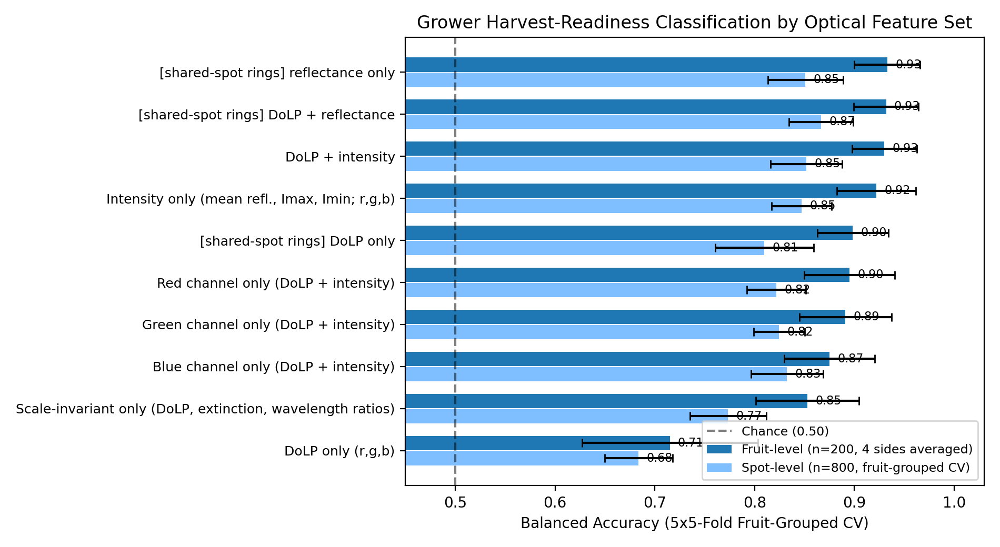 | 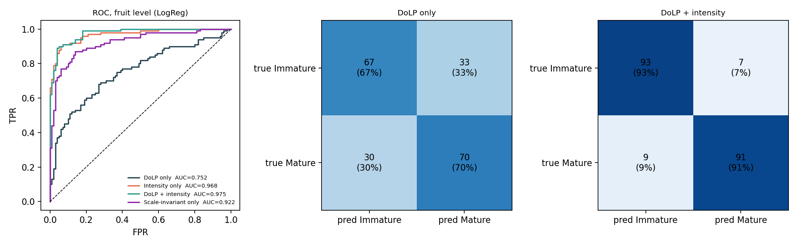 |

| Optical Feature Distributions by Class | Native $5^\circ$ vs. $10^\circ$ Subsampled Grid |
| :---: | :---: |
| 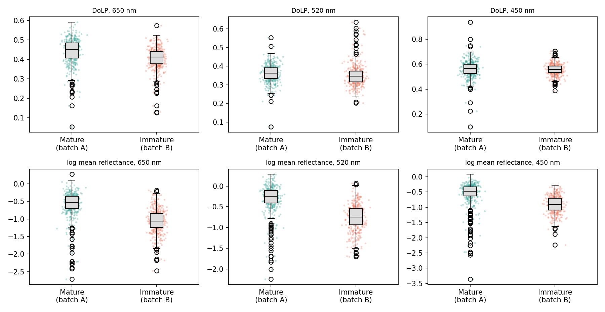 | 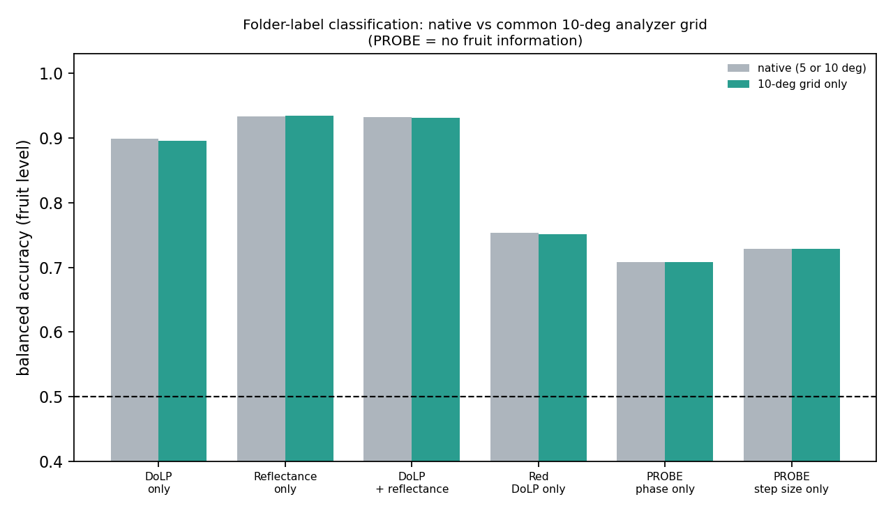 |

---

## 5. Physical Significance of Key Polarizer Angles ($50^\circ, 135^\circ, 140^\circ, 200^\circ$) Across All 4 Sides

Full table: [`farmersClassification/results/fruit_angle_uniqueness_all4sides.csv`](results/fruit_angle_uniqueness_all4sides.csv)

| Angle | Avocado Relative Brightness $I(\theta)/\bar{I}$ (R / G / B) | Same-Fruit `log R` ICC Across Sides 1–4 (R / G / B) | Same-Fruit Relative Brightness (`rel`) ICC Across Sides 1–4 (R / G / B) | Same-Fruit Residual (`res`) ICC Across Sides 1–4 (R / G / B) | Physical Significance on the 3D Avocado (Sides 1–4) |
| :--- | :---: | :---: | :---: | :---: | :--- |
| **$50^\circ$** | **1.343 / 1.305 / 1.457** | 0.218 / 0.264 / 0.217 | 0.150 / **0.394** / 0.031 | 0.164 / 0.188 / 0.263 | **Co-polarized bright glare peak** ($+31\%$ to $+46\%$ above mean) |
| **$135^\circ$** | **0.654 / 0.729 / 0.556** | **0.227 / 0.319 (#1) / 0.187** | 0.194 / **0.379** / 0.087 | 0.050 / 0.118 / 0.176 | **#1 most consistent intrinsic fruit brightness (`log R`) in Green** (glare blocked) |
| **$140^\circ$** | **0.595 / 0.671 / 0.471** | 0.210 / **0.314 (#3)** / 0.171 | 0.181 / **0.406** / 0.070 | 0.149 / 0.227 / 0.198 | **Cross-polarized subsurface window** (high `log R` & Green `rel` ICC) |
| **$200^\circ$** | **1.034 / 1.014 / 1.054** | 0.197 / 0.250 / 0.221 | **0.364 (#1) / 0.397 / 0.380 (#1)** | **0.321 / 0.417 / 0.433** | **#1 in Red & Blue `rel` ICC and top curve-deviation ICC** (steepest inflection point) |
| **$275^\circ$** | **1.209 / 1.177 / 1.289** | **0.229** / **0.288** / **0.222** | 0.203 / **0.399** / 0.167 | 0.094 / 0.164 / 0.176 | **High bright-shoulder repeatability** across all 4 sides |

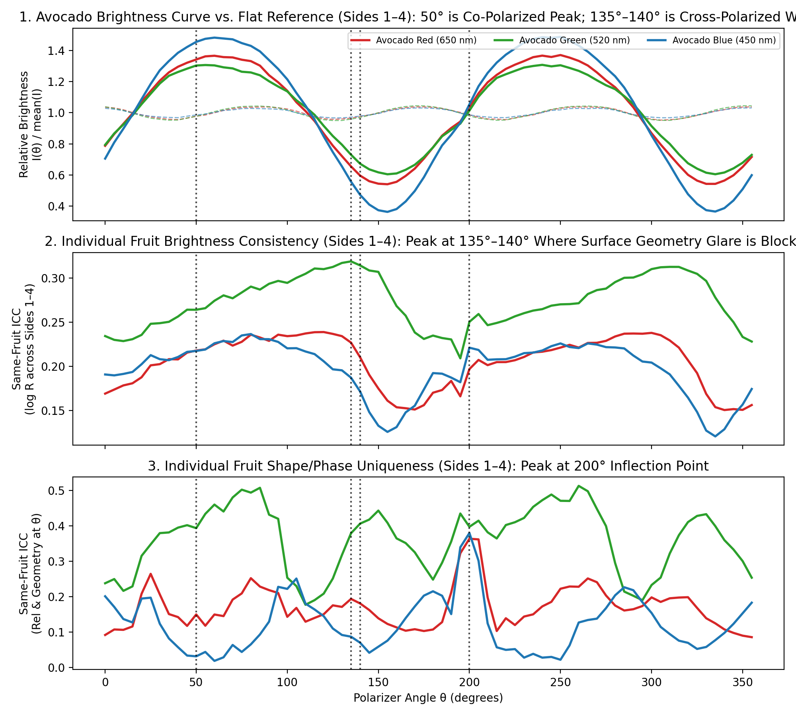

| Per-Angle Class Separation Across $0^\circ\text{--}355^\circ$ | Sinusoidal vs. Residual Angle Decomposition |
| :---: | :---: |
| 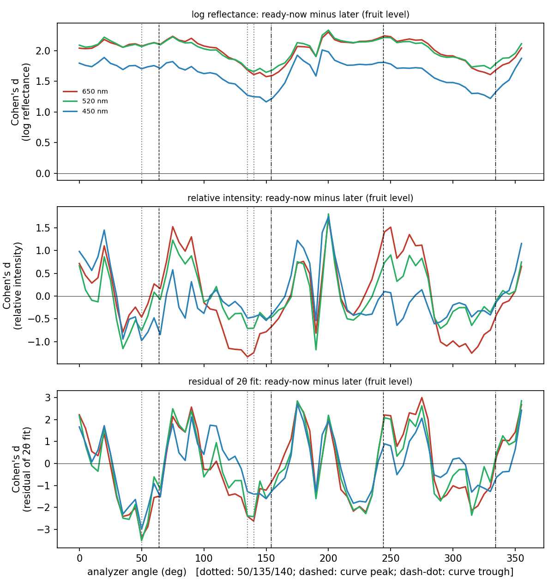 | 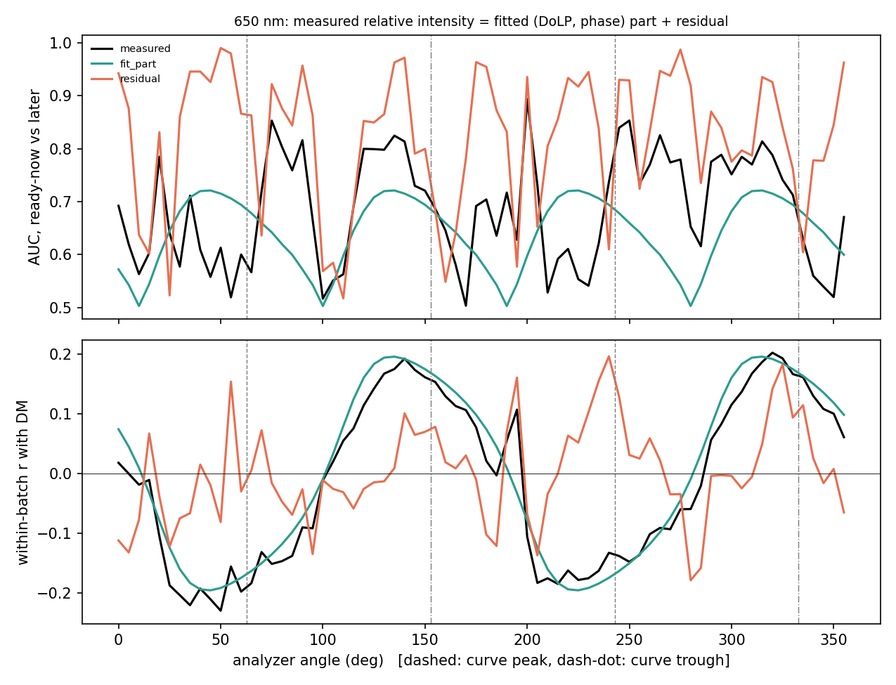 |

---

## 6. Reproducing the Pipeline & ML Benchmarks

```bash
# 1. Run feature-set ablation across LogReg, SVM-RBF, and Random Forest
python3 farmersClassification/02_classify.py

# 2. Run 10-degree vs. 5-degree angular resolution verification
python3 farmersClassification/03_classify_10deg_only.py

# 3. Run full 9-algorithm ML comparison, ROC curves, and confusion matrices
python3 farmersClassification/12_ml_algorithms_comparison.py

# 4. Run 72-angle significance, decomposition, and 4-side fruit uniqueness analysis
python3 farmersClassification/05_angle_significance.py
python3 farmersClassification/06_angle_decomposition.py
python3 farmersClassification/11_angle_uniqueness_all4sides.py
```
